<h1 align="center">
  <br />
  CyVault
</h1>

## Overview

CyVault lets a user sign in and manage their balances: record purchases and income, see the total per currency, and edit or delete entries. The balances are stored per user in the Azure backend.

## Screenshots

<p align="center">
  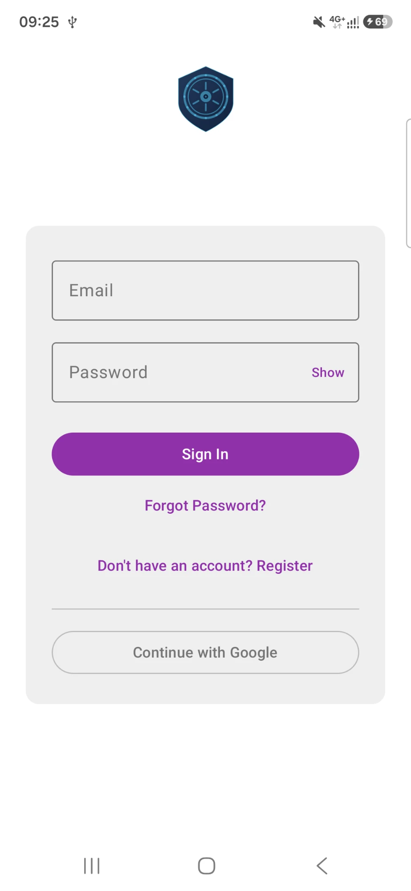
  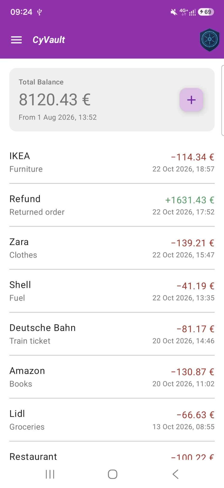
  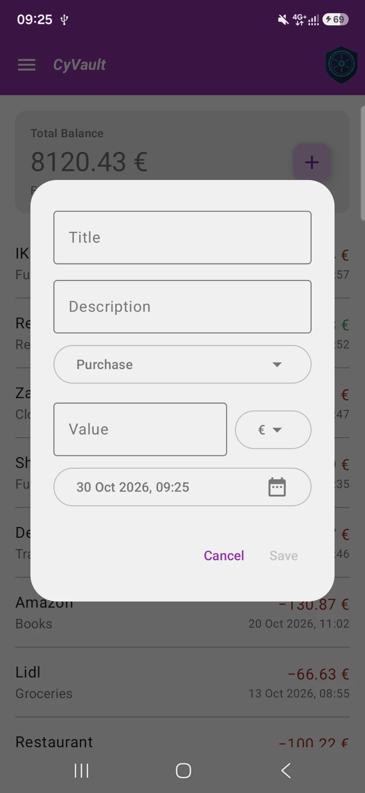
  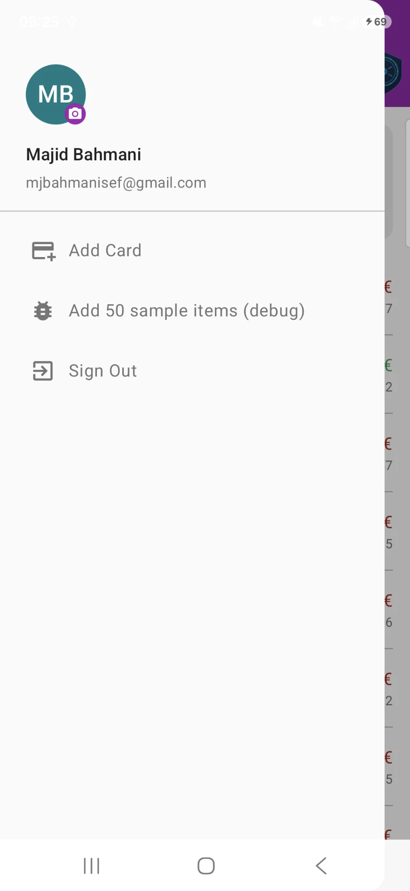
</p>

<p align="center">
  <sub>Sign in · Home · Add a balance · Drawer</sub>
</p>

## Features

- **Authentication**
  - Microsoft Entra External ID with MSAL native authentication: the app's own Compose screens, no browser page
  - Email/password sign-up with email verification code
  - Sign-in, sign-out, forgot password (sends the reset code; entering the code and a new password isn't built yet)
  - **Sign in with Google:** through Entra External ID with Google as an identity provider (MSAL browser flow in a browser tab)
- **Balances**
  - Add a purchase or income with a title, description, amount, currency, and date and time
  - Home shows the total per currency and every balance, newest first; tap one to edit it
  - Long press to select several balances, then select all or delete them together
  - Saved per user through the Azure balances API
- **Drawer**: the signed-in user (avatar, name, email) and sign-out
- **Profile photo**: tap the drawer avatar to pick a photo with the system Photo Picker. It's uploaded to the Azure backend with the user's Entra access token, cached in app-private storage, and removed from the device on sign-out

## Architecture

The project uses **Clean Architecture** with **MVI**, split into feature modules:

```
CyVault
├── androidApp       Android entry point (Application, MainActivity, the app's MSAL config)
├── app              Composition root: root Compose App, NavHost, Koin setup
├── core             Shared non-UI code: Ktor client, platform DI, I/O dispatcher
├── auth             Sign-in and session library: AuthClient (MSAL native auth), reusable
├── devicekey        Device signing keys: DeviceKeyStore (biometric-gated Android Keystore key), reusable
├── systemdesign     Design system: theme, colors, typography, shapes, reusable components
├── feature
│   ├── authentication   Feature: sign-in / sign-up / Google / password reset
│   └── vault            Feature: vault home with the balances, add-card
└── azure-backend    Azure Functions API (.NET 10) + Bicep infrastructure, deployed with azd
```

`:auth` is a library, not a feature: it has no screens and no CyVault types or IDs, and it doesn't
depend on `:core`, so another app can use it as it is. It exposes `AuthClient` (sign-in, sign-up,
Google, password reset, current user, access tokens, sign-out) and `AuthUser`. The features call it
from their data layer and map `AuthUser` to their own models: `feature:authentication` in
`AuthRepositoryImpl`, the vault in `home/data/AccountRepositoryImpl` and `ProfilePhotoApiService`.
The app supplies the Entra registration: `androidApp` passes `MsalConfig(R.raw.auth_config_native_auth)`
to Koin.

`:devicekey` is a library in the same way: no screens, no CyVault types and no `:core`. It exposes
`DeviceKeyStore`, which makes one EC P-256 key per account in the Android Keystore (StrongBox when the
phone has it). The key only signs right after a fingerprint or face check, and adding a new
fingerprint or face invalidates it; the private key never leaves the hardware. `sign` shows the system
`BiometricPrompt` with the transfer's amount and payee and signs with the key it unlocks (SHA256withECDSA),
so it needs Android 9 (API 28) or later: older phones get no key and can't send money. On iOS it's a
stand-in that makes no key yet. The vault's `device/` package uses it to enroll the phone with the API
(`POST /me/devices`) when the vault opens, and keeps the device ID the API returns in a DataStore
(never SharedPreferences).

Features never depend on each other and know nothing about navigation: they don't depend on
Navigation Compose and have no routes. Each feature exposes plain screen composables
(`AuthScreen`, `VaultHomeScreen`, `AddCardScreen`) that only report events through callbacks
(`onAuthSuccess`, `onAddCardClick`, `onCardSaved`, `onSignedOut`, …). `app` defines every route
(`navigation/Routes.kt`), owns the only `NavHost` and decides where every event leads, and it
loads each feature's public Koin module.

Each feature module has its own layers. A single-flow feature (authentication) keeps them at
the module root; a multi-screen feature (vault) has one package per screen, each with its
own layers and Koin module:

```
feature/vault/…/feature/vault/
├── home/           balances + totals per currency, drawer with sign-out and the profile photo
                    (Azure photo API client, on-device cache, photo picker)
├── addcard/        add a card
│   ├── data/           remote services + DTOs, mappers, repository implementations
│   ├── domain/         models, repository interfaces, use cases
│   ├── presentation/   Compose screens + ViewModel (State / Intent / Effect)
│   └── di/             the screen's internal Koin module
├── VaultScreens.kt the public screens: VaultHomeScreen, AddCardScreen (events out)
└── di/             vaultFeatureModule: the feature's only public Koin module
```

### Architecture diagram

The diagram below shows the modules as they are today: the two feature modules (authentication, and vault with its screen packages), the shared modules (`:auth`, `:devicekey`, `:core`, `:systemdesign`), the dependency rules, navigation, how vault signs out through `:auth`'s `AuthClient`, and the external services.

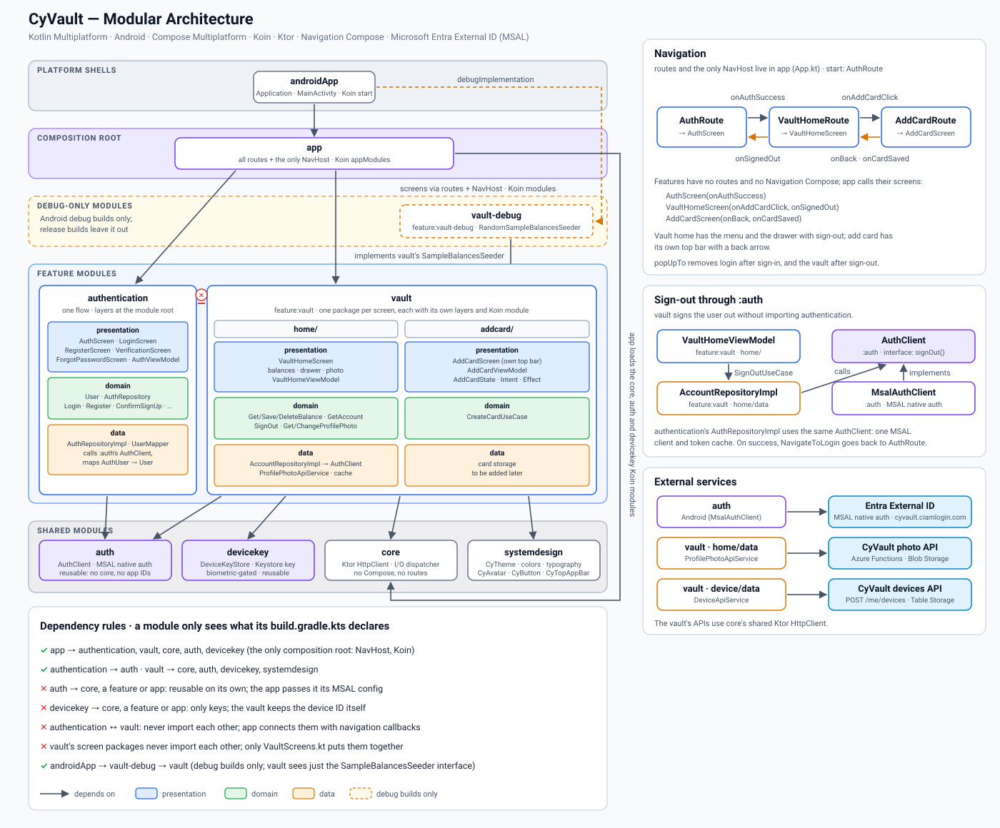

### Google sign-in flow

On Android, Google sign-in goes through Entra External ID, with Google set up as an identity provider in the tenant. Native auth only covers the in-app email screens, so for Google the app uses MSAL's browser flow (`acquireToken` with the `google.com` domain hint): it opens Entra's sign-in page in a browser tab, Entra hands the user over to Google, and Google sends a one-time code back to Entra's redirect URI. Entra exchanges that code for the user's identity with the Google client secret, then issues its own token to the app. The app never talks to Google directly, and only Entra holds the client secret.

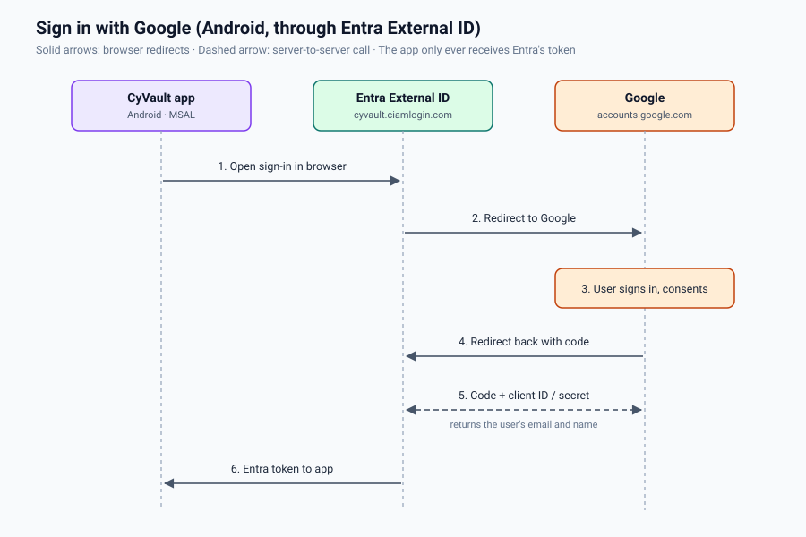

### Profile photo API: Function App access to Blob Storage

Profile photos live in a private Blob Storage container behind the Azure Functions API in `azure-backend/` (`PUT`, `GET` and `DELETE /api/me/avatar`). On Android, the app asks MSAL for an access token with the API's `Profile.ReadWrite` scope and sends it as `Authorization: Bearer`, only on these requests. No route takes a user ID. The Function validates the upload by decoding it, turns it upright, downscales it to at most 512 px and re-encodes it as JPEG, which also drops EXIF metadata such as GPS location. The Function App reaches Storage through its **Managed Identity**, so no storage keys or connection strings exist anywhere. The SDK (`DefaultAzureCredential`) gets a token for that identity from Entra ID and sends it with each blob request. Blob Storage validates the token and checks the identity's **IAM role assignment** (`Storage Blob Data Contributor` on the `avatars` container) before allowing the write. Users get no Storage permissions at all: the Function builds every blob path from the `oid` in the user's validated access token, so each account can only reach its own photo.

Balances use the same pattern with Table Storage (`GET` and `POST /api/me/balances`, `GET /api/me/balance-totals`, and `GET`, `PUT` and `DELETE /api/me/balances/{id}`), behind the `Balance.ReadWrite` scope. Each row's `PartitionKey` is the caller's `oid` and its `RowKey`, which is also the balance ID, is `{invertedTicks}_{uniqueId}`, so the table itself keeps a user's balances newest first. `GET /api/me/balances` returns them all, or with `?pageSize=50` one page as `{ "items": [...], "continuationToken": "..." }`, where `&continuationToken=` fetches the next page and a null token means there are no more. `GET /api/me/balance-totals` returns `[ { "currency": "EUR", "total": 1250.50 } ]` from one stored row in the same partition (`RowKey` `~totals`), which every balance write updates in one batch with the balance, so reading a total doesn't depend on how many balances the user has. A currency whose total is exactly zero isn't listed. The Function's identity has `Storage Table Data Contributor` on the `balances` table only. A `POST` body is `{ "id": "<unique ID>", "name": "Main account", "description": "Daily spending", "amount": 1250.50, "currency": "EUR", "date": "2026-10-28T09:00:00Z", "cardId": "<card ID>", "type": "Income" }`: the client picks the unique ID once per new balance, so a retry replaces the row instead of adding another. A `PUT` body is the same without the ID and with an optional date; a new date moves the row, so the response carries the balance's new ID. The amount is kept as a decimal string so money is never rounded.

Cards follow the same pattern (`GET /api/me/cards`, and `PUT` and `DELETE /api/me/cards/{id}`), behind the `Card.ReadWrite` scope. A `PUT` body is `{ "cardNumber": "4111 1111 1111 1111", "phoneNumber": "912 345 678", "bankName": "Millennium" }` (`bankName` required, at most 50 characters): the card number must be 16 to 19 digits (there's no Luhn check), and the phone number is stored in E.164 (`+351912345678`; a 9-digit number starting with 9 gets `+351`). The full number is stored only encrypted, with envelope encryption: an AES-256 data key per card, wrapped by `card-key`, an RSA key in Azure Key Vault whose private key never leaves the vault (`CardEncryption`). Each row keeps the AES-GCM ciphertext (`EncryptedCardNumber`), the wrapped data key (`WrappedKey`) and the `card-key` version that wrapped it (`KeyId`), so cards still decrypt after the key is rotated. The card's last four digits are kept in clear for the card list, with the card's brand (Visa, Mastercard, Maestro or Other), which the Function works out from the number's first digits. Two tables hold a card: `cards` (`PartitionKey` = the caller's `oid`, `RowKey` = the card ID) for the user's list, and `phones` (`PartitionKey` = the phone number), which maps a phone number to the user and card it's linked to, so a transfer to a phone number finds its owner without scanning every user's cards. Because a phone number is a `phones` row's whole key, linking a number that's already linked fails, and the `PUT` returns `409 Conflict`: one phone number, one card. The Function's identity has `Storage Table Data Contributor` on each of the two tables, and `Key Vault Crypto User` on the vault, enough to wrap and unwrap but not to read secrets or manage keys.

Devices are the phones a user enrolled for signing transfers (`GET /api/me/devices`, `POST /api/me/devices`, and `DELETE /api/me/devices/{id}`), behind the `Profile.ReadWrite` scope. After sign-in the app creates an EC P-256 key pair in the Android Keystore or iOS Secure Enclave; the private key never leaves it. A `POST` body is `{ "publicKey": "<base64 DER SubjectPublicKeyInfo>", "deviceName": "Pixel 8" }` (`deviceName` optional, at most 50 characters); the Function rejects any key that isn't P-256, stores it re-encoded in one canonical form, and returns `201 Created` with the device ID it picked (a GUID), which the app keeps and sends with each signature. A retry with the same key returns the same device (`200`) instead of enrolling it twice. `DELETE` doesn't delete the row: it sets `RevokedAt`, so the device can't sign anything new but its earlier signatures can still be checked, and its key can't be enrolled again (`409 Conflict`). Rows live in the `devices` table (`PartitionKey` = the caller's `oid`, `RowKey` = the device ID), and the Function's identity has `Storage Table Data Contributor` on that table. Enrolling needs only the sign-in for now: there's no SMS or email code yet, so a stolen password is enough to enroll a phone.

Transfers are signed with that device key (the API side is built; the app doesn't sign yet, so until it does every transfer from the app is rejected). The app first asks for a challenge: `POST /api/me/transfers/challenge` with the same body as the transfer (`transferId`, `cardId`, `phoneNumber`, `amount`, `currency`), which runs the transfer's checks and returns `{ "nonce", "payload", "expiresAt" }`. The nonce is 32 random bytes (base64url), single-use and valid for 2 minutes, and its row in the `challenges` table keeps the details it was issued for. `payload` is the exact text to sign, one line each for the nonce and the details; the app signs its UTF-8 bytes with the Keystore key (SHA256withECDSA, DER) after a fingerprint or face check, and never rebuilds it. `POST /api/me/transfers` then adds `deviceId`, `nonce` and `signature` (base64). The server moves the money only when the device is the caller's and not removed (`403` otherwise), the nonce is the caller's and unexpired (`410`: ask for a new one), the details match the challenge (`400`), and the signature checks out against that device's public key (`422`). A used challenge still approves its own transfer again, so a retry after a lost response finishes it, but never another one. That makes each approval count for one transfer, this amount to this payee (PSD2 dynamic linking). Five wrong signatures in a row block signing for 30 minutes (`423 Locked`, PSD2 RTS Art. 4(3)(b)); a valid one resets the count. The transfer row keeps the device ID, nonce and signature as proof of approval. The Function's identity has `Storage Table Data Contributor` on the `challenges` table, which also holds each user's failed-signature count. Used and expired challenges aren't cleaned up yet.

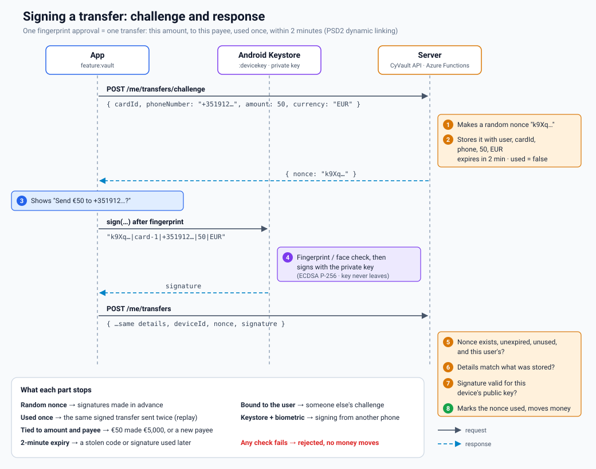

The app gets the access token from Entra's token endpoint, which MSAL discovers from the tenant's metadata, and the Function checks it against Entra's published signing keys:

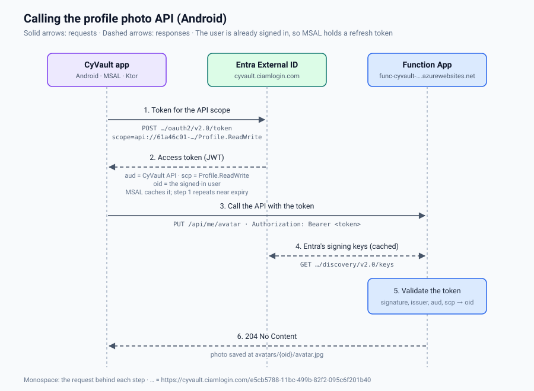

Inside the Function App, the validated token's `oid` decides the blob, and the Function's own identity reaches Storage:

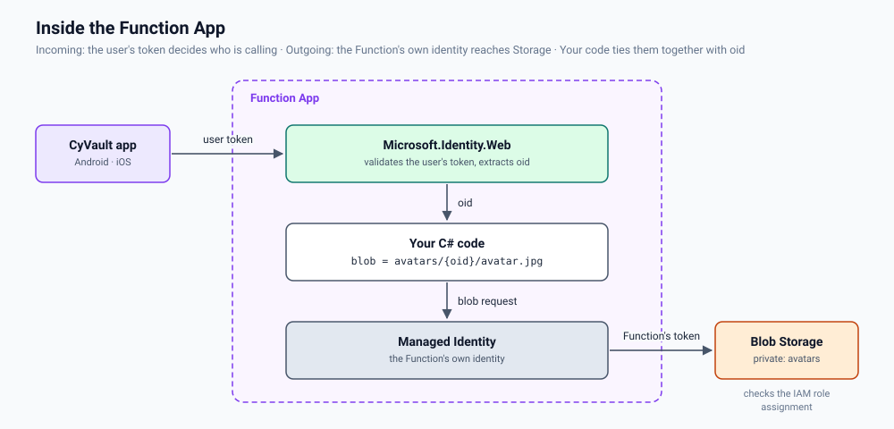

The sequence below shows the outgoing step, from the Function to Blob Storage, in detail.

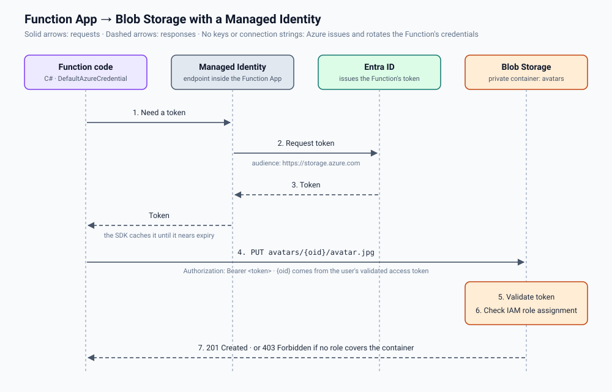

### Server-side sign-out: revoking the user's Entra sessions

Signing out on Android also ends the user's sessions in Entra, not just on the phone. Before clearing the MSAL cache, the app calls `POST /api/me/signout` with its CyVault API token. The Function takes the `oid` from the validated token and calls Microsoft Graph's `revokeSignInSessions` for that user, which makes Entra reject every refresh token the user holds, on all devices. Access tokens already issued stay valid until they expire (about an hour), because the API checks only their signature and expiry. The revoke is best effort: offline, or if Graph fails, the user is still signed out on the phone.

Users and their sessions aren't Azure resources, so this access isn't an IAM role like Storage's. It's the Graph application permission `User.RevokeSessions.All`, granted to the **CyVault API app registration** in the External ID tenant. The mobile app has no Graph permission. The Function's Managed Identity lives in the Azure subscription's tenant, so it can't hold that permission itself. Instead, a **federated credential** on the CyVault API registration trusts the Managed Identity, and the Function trades its Managed Identity token for a Graph token as the CyVault API app. The setup steps are in [`azure-backend/README.md`](azure-backend/README.md#server-side-sign-out).

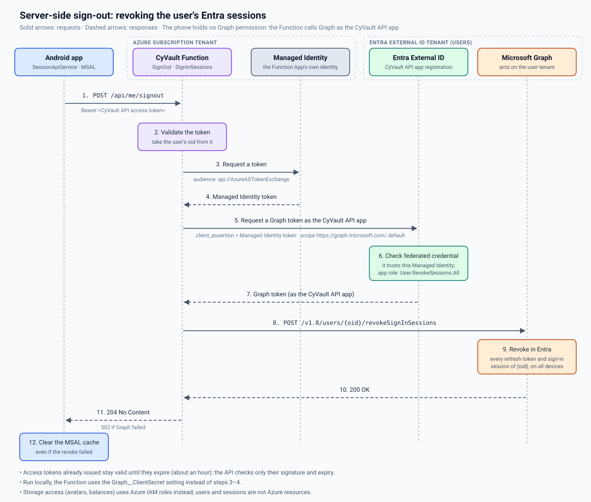

### Push notifications: workload identity federation with Google

When money arrives, the receiver gets a push through Firebase Cloud Messaging (FCM, HTTP v1) on each phone where they're signed in, with or without a fingerprint set up. The Function reaches FCM without any Google key: through **workload identity federation**, Google trusts the Function's Azure Managed Identity. The Function gets an Azure token from Entra ID, exchanges it at Google STS for a short-lived federated token, uses that to act as a Firebase service account that has no key, and sends the push with the resulting one-hour access token, which it caches. Entra ID and Google never talk to each other: STS only checks the Azure token against Entra's published public keys. The push carries data only, so the app writes the notification in the phone's language. The setup steps are in [`azure-backend/README.md`](azure-backend/README.md#push-notifications).

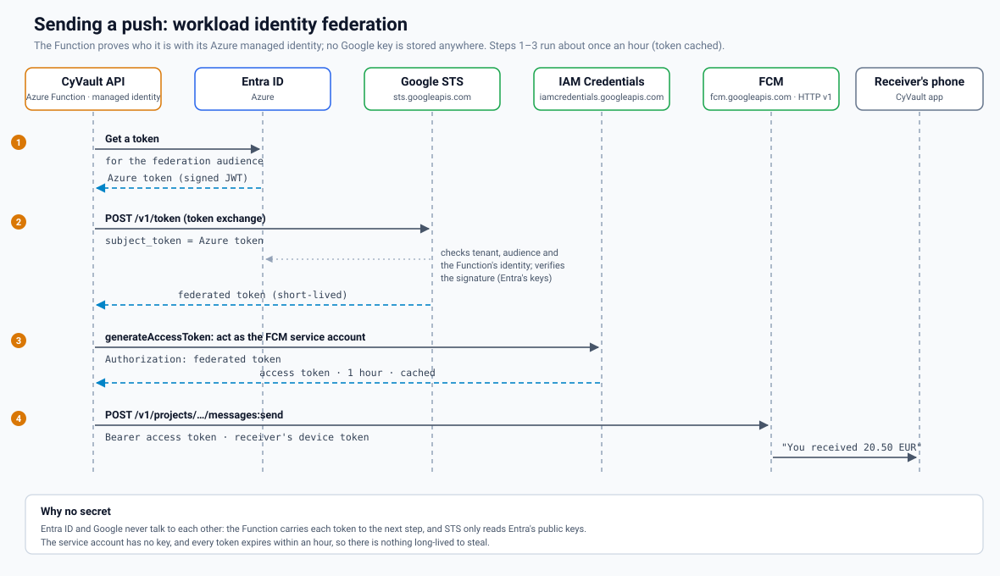

FCM knows app installs, not users. After sign-in, the app sends its FCM token to `PUT /api/me/push-tokens`, and the Function saves it under the caller's `oid`, first removing it from any other account that used the phone before. To push, the Function sends to every token saved for the receiver. Sign-out removes the phone's token, and a token FCM reports as unregistered is dropped.

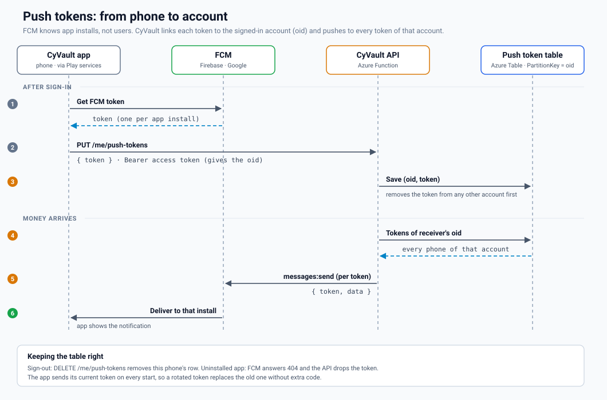

On the phone, FCM sends the push down the single connection Google Play services keeps open for every app. Play services hands it to CyVault over Binder IPC, and Android starts the app's process if needed (high priority works even in Doze). `CyVaultMessagingService.onMessageReceived` builds the notification, which is shown only if the user allowed notifications.

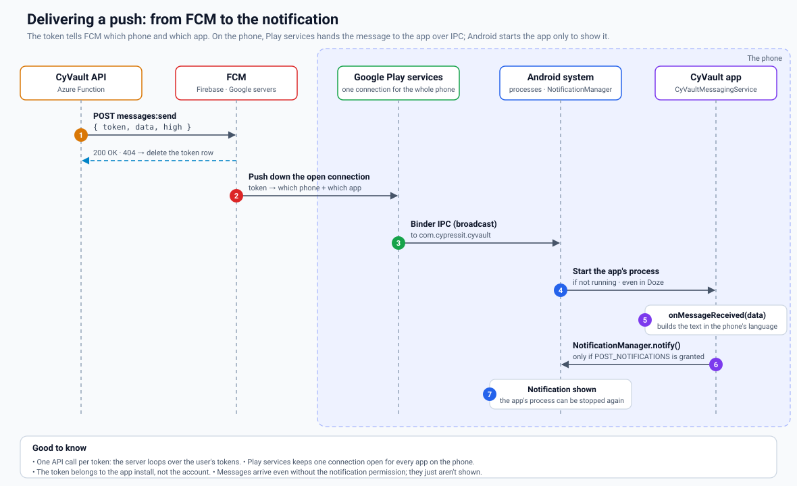

### MVI

Every screen has three types:

- **State**: an immutable data class that the screen renders, exposed as `StateFlow`.
- **Intent**: a sealed class of user actions sent to the ViewModel.
- **Effect**: one-off events (snackbar, navigation, opening an external URL), delivered through a `Channel` so each one is consumed **exactly once** and never replayed after recomposition or rotation.

See [`docs/Effect.md`](docs/Effect.md) for why `Channel` is used instead of `SharedFlow`.

### Platform-specific code

| Concern | Shared API | Android |
|---|---|---|
| Authentication (`:auth`) | `AuthClient` interface, bound in `authClientModule` | `MsalAuthClient`: MSAL native auth (Entra External ID); `ActivityProvider` gives MSAL's browser sign-in the on-screen activity |
| Profile photo | `rememberProfilePhotoPicker` (`expect`/`actual`); `PickedPhotoReader` and `AvatarFileStore` interfaces bound in `homePlatformModule` | Photo Picker; `AndroidPickedPhotoReader` turns the photo upright from EXIF and scales it to 1024 px; `AndroidAvatarFileStore` caches it in `filesDir` |
| Device key (`:devicekey`) | `DeviceKeyStore` interface, bound in `deviceKeyModule` | `AndroidDeviceKeyStore`: EC P-256 key in the Android Keystore (StrongBox when available), signs after the system `BiometricPrompt` (API 28+) |
| Device ID | `DeviceIdStore` (DataStore Preferences); the file's folder comes from `devicePlatformModule` | `filesDir` |
| DI | `platformModule` | Ktor OkHttp engine |

## Tech stack

| Area | Library |
|---|---|
| Language | Kotlin 2.4 (Multiplatform) |
| UI | Compose Multiplatform 1.11, Material 3 |
| Navigation | Navigation Compose (KMP), type-safe `@Serializable` routes |
| Async | Kotlin Coroutines & Flow |
| DI | Koin 4 |
| Networking | Ktor 3 (OkHttp), kotlinx.serialization |
| Auth | Microsoft Entra External ID + MSAL 8 (native auth) |
| Backend | Azure Functions (.NET 10 isolated, Flex Consumption), Microsoft.Identity.Web, Blob Storage, SkiaSharp, Bicep + Azure Developer CLI |

## Getting started

### Requirements

- Android Studio (latest) with the Kotlin Multiplatform plugin
- JDK 17+
- An Azure account (only needed to use your own Entra tenant)
- For the Azure backend: see [`azure-backend/README.md`](azure-backend/README.md#requirements)

### 1. Authentication

**Microsoft Entra External ID (optional: use your own tenant)**

1. In the [Entra admin center](https://entra.microsoft.com), create an **external** tenant.
2. In that tenant, register an app (single tenant) and add the **Android** platform with the package
   name `com.cypressit.cyvault` and your signing key's hash:

   ```bash
   keytool -exportcert -alias androiddebugkey -keystore ~/.android/debug.keystore -storepass android | openssl sha1 -binary | openssl base64
   ```

3. Under **Authentication → Settings**, turn on **Allow public client flows** and **Enable native authentication**.
4. Create a user flow with **Email with password** and the **Display Name** attribute, and add the app to it.
5. Under **API permissions**, add `openid` and `offline_access`, then grant admin consent.
6. Put your client ID, tenant subdomain and redirect URI in
   `androidApp/src/main/res/raw/auth_config_native_auth.json`, and your signature
   hash in the MSAL `BrowserTabActivity` entry of `androidApp/src/main/AndroidManifest.xml`.
7. Optional, for **Sign in with Google**:
   - In the [Google Cloud Console](https://console.cloud.google.com), create a project, set up the
     OAuth consent screen (Google Auth Platform) as **External**, and add your Gmail address as a
     test user while the app is in Testing mode.
   - Create an OAuth client of type **Web application** with these redirect URIs, where `<tenant-ID>`
     is your tenant's ID and `<tenant>` its subdomain:

     ```
     https://login.microsoftonline.com
     https://login.microsoftonline.com/te/<tenant-ID>/oauth2/authresp
     https://login.microsoftonline.com/te/<tenant>.onmicrosoft.com/oauth2/authresp
     https://<tenant-ID>.ciamlogin.com/<tenant-ID>/federation/oidc/accounts.google.com
     https://<tenant-ID>.ciamlogin.com/<tenant>.onmicrosoft.com/federation/oidc/accounts.google.com
     https://<tenant>.ciamlogin.com/<tenant-ID>/federation/oauth2
     https://<tenant>.ciamlogin.com/<tenant>.onmicrosoft.com/federation/oauth2
     ```

   - In Entra, go to **External Identities → All identity providers → Google** and enter the
     Google client ID and secret, then tick **Google** under the user flow's **Identity providers**.
     The secret stays in Entra; the app never needs it.

### 2. Azure backend (profile photo and balances API)

The backend's requirements, environments, local run and deployment are in
[`azure-backend/README.md`](azure-backend/README.md).

### 3. Run

`./gradlew :androidApp:assembleDebug`, or use the run configuration in Android Studio.

### 4. Publish

Publishing to Google Play is described in [`docs/google-play.md`](docs/google-play.md); after the first
release, a version tag publishes through [Continuous delivery](#continuous-delivery).

## Continuous integration

The same flow runs in two places, on every pull request and push to `main`:
[`.github/workflows/ci.yml`](.github/workflows/ci.yml) in GitHub Actions and
[`azure-pipelines.yml`](azure-pipelines.yml) in Azure Pipelines. Changes that only touch the backends,
`docs/` or Markdown skip it.

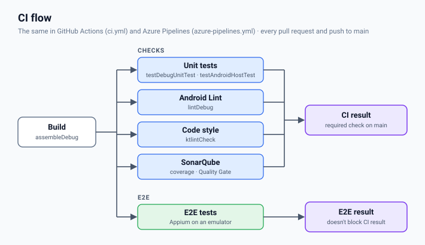

| Job | Gradle task |
|---|---|
| Build | `:androidApp:assembleDebug` |
| Unit tests | `testDebugUnitTest testAndroidHostTest` |
| Android Lint | `:androidApp:lintDebug` (also lints the library modules) |
| Code style | `ktlintCheck` (rules in `.editorconfig`; fix with `./gradlew ktlintFormat`) |
| SonarQube | `koverXmlReport`, then SonarQube Cloud analysis; fails if the Quality Gate fails |
| CI result | Fails if any job above failed |
| E2E tests | `:e2e:e2eTest` through `e2e/run-e2e.sh`: Appium drives the debug APK on an emulator |
| E2E result | Fails if E2E tests failed; **CI result** doesn't depend on it |

In GitHub Actions the first job, **Changes**, does the path filtering; Azure does it with its
`paths.exclude` trigger and groups the checks in a **Verify** stage.

To set it up:

1. In Azure DevOps, create a pipeline from this GitHub repository and pick the existing `azure-pipelines.yml`.
2. In GitHub, add a branch protection rule on `main` that requires the **CI result** check.
3. For E2E, create a test account in the debug Entra tenant (the tests delete every balance on it) and add
   its credentials as `E2E_EMAIL` and `E2E_PASSWORD`: repository secrets in GitHub, secret pipeline variables
   in Azure DevOps. The Azure E2E stage needs an agent with KVM for the emulator.
4. For SonarQube, first turn off Automatic Analysis in the SonarQube Cloud project (Administration →
   Analysis Method). Both CIs report to the same project, so the latest analysis of a branch is the one shown.
   - GitHub Actions: add a SonarQube Cloud token as the repository secret `SONAR_TOKEN`, and the
     repository variables `SONAR_ORGANIZATION` and `SONAR_PROJECT_KEY` with your project's values. Until
     `SONAR_PROJECT_KEY` is set the SonarQube job is skipped.
   - Azure Pipelines: install the SonarQube Cloud extension and add a service connection named `SonarCloud`;
     the organization and project keys are in `azure-pipelines.yml`. `sonarEnabled: false` leaves the
     SonarQube job out of the run.
   - Quality Gate: both scans wait for SonarQube Cloud's verdict (`sonar.qualitygate.wait=true`, up to 5 minutes).
     When the gate fails, the SonarQube job fails and so does **CI result**, which blocks the PR. What the gate
     checks is set in SonarQube Cloud (Project → Quality Gate); the default "Sonar way" looks at new code only:
     no new bugs or vulnerabilities, all new security hotspots reviewed, ≥ 80% coverage and ≤ 3% duplication.
     The failing conditions are on the project's page in SonarQube Cloud.

To run the E2E tests locally, start an emulator or connect a phone, start `appium` (with `ANDROID_HOME`
and `JAVA_HOME` set), put the test account in the git-ignored `e2e/.env`, then run `./e2e/run-e2e.sh`.

## Continuous delivery

Pushing a version tag releases the app: [`.github/workflows/cd.yml`](.github/workflows/cd.yml) builds
a signed AAB and APK, uploads the AAB (with R8's mapping file) to Google Play's **production** track, and
publishes the APK as a GitHub Release. Google reviews each production release before it goes live.

```bash
git tag v1.1.0
git push origin v1.1.0
```

The tag sets the version: `v1.2.3` → versionName `1.2.3`, versionCode `10203` (major·10000 + minor·100 +
patch, minor and patch below 100). Local builds keep `defaultConfig`'s version. The build job alone holds
the upload key, the Play job alone reaches Google Play, and only the release job may write to the
repository. Google Play is reached through **workload identity federation**, like the backend's pushes:
Google trusts this repository's GitHub token, so no service account key exists.

To set it up, once:

1. **Upload key.** The keystore `local.properties` points to (`release.storeFile`):

   ```bash
   base64 -w0 <keystore.jks> | gh secret set CYVAULT_KEYSTORE_BASE64 --repo mbahmani90/CyVault-Azure
   gh secret set CYVAULT_KEYSTORE_PASSWORD --repo mbahmani90/CyVault-Azure
   gh secret set CYVAULT_KEY_PASSWORD --repo mbahmani90/CyVault-Azure
   gh variable set CYVAULT_KEY_ALIAS --body <key alias> --repo mbahmani90/CyVault-Azure
   ```

2. **Google Cloud** (Cloud Shell, project `cyvault-512912`): a `play-publisher` service account that
   only this repository's workflows can act as:

   ```bash
   gcloud services enable androidpublisher.googleapis.com
   gcloud iam service-accounts create play-publisher --display-name "CyVault Play uploads"
   gcloud iam workload-identity-pools create github --location global --display-name "GitHub"
   gcloud iam workload-identity-pools providers create-oidc cyvault-repo --workload-identity-pool github --location global --issuer-uri "https://token.actions.githubusercontent.com" --attribute-mapping "google.subject=assertion.sub,attribute.repository=assertion.repository" --attribute-condition "assertion.repository == 'mbahmani90/CyVault-Azure'"
   gcloud iam service-accounts add-iam-policy-binding play-publisher@cyvault-512912.iam.gserviceaccount.com --role roles/iam.workloadIdentityUser --member "principalSet://iam.googleapis.com/projects/949572795462/locations/global/workloadIdentityPools/github/attribute.repository/mbahmani90/CyVault-Azure"
   ```

   Then the two repository variables:

   ```bash
   gh variable set PLAY_WORKLOAD_IDENTITY_PROVIDER --body projects/949572795462/locations/global/workloadIdentityPools/github/providers/cyvault-repo --repo mbahmani90/CyVault-Azure
   gh variable set PLAY_SERVICE_ACCOUNT --body play-publisher@cyvault-512912.iam.gserviceaccount.com --repo mbahmani90/CyVault-Azure
   ```

3. **Play Console → Users and permissions → Invite new users:** `play-publisher@cyvault-512912.iam.gserviceaccount.com`,
   with *Release to production, exclude devices, and use Play App Signing* and *View app information* for
   CyVault. The API may take up to a day to accept it.
4. Optional: in the repository settings, add required reviewers to the `google-play` environment, so each
   upload waits for an approval.

The Play API can't create an app's first release: that one is uploaded by hand
([`docs/google-play.md`](docs/google-play.md)).

## Security notes & roadmap

CyVault is a portfolio / learning project and **not production-ready**. The known gaps and the planned fixes are:

- **Card data**: the demo model holds a card number and CVV. A real app must never store the CVV and should keep only a **tokenised** card reference from a PCI DSS-compliant provider.
- **Card API**: `CardApiService` points to a placeholder endpoint. Planned: move it to the Azure Functions API, with every card keyed by the caller's `oid`.
- **Local storage**: planned: SQLDelight for offline caching, with Android Keystore encryption for sensitive data.
- **Auth**: finish the forgot-password flow (code + new password).
- More unit and UI tests for use cases and ViewModels.

## Author

**Majid Bahmani** · [GitHub](https://github.com/mbahmani90)
