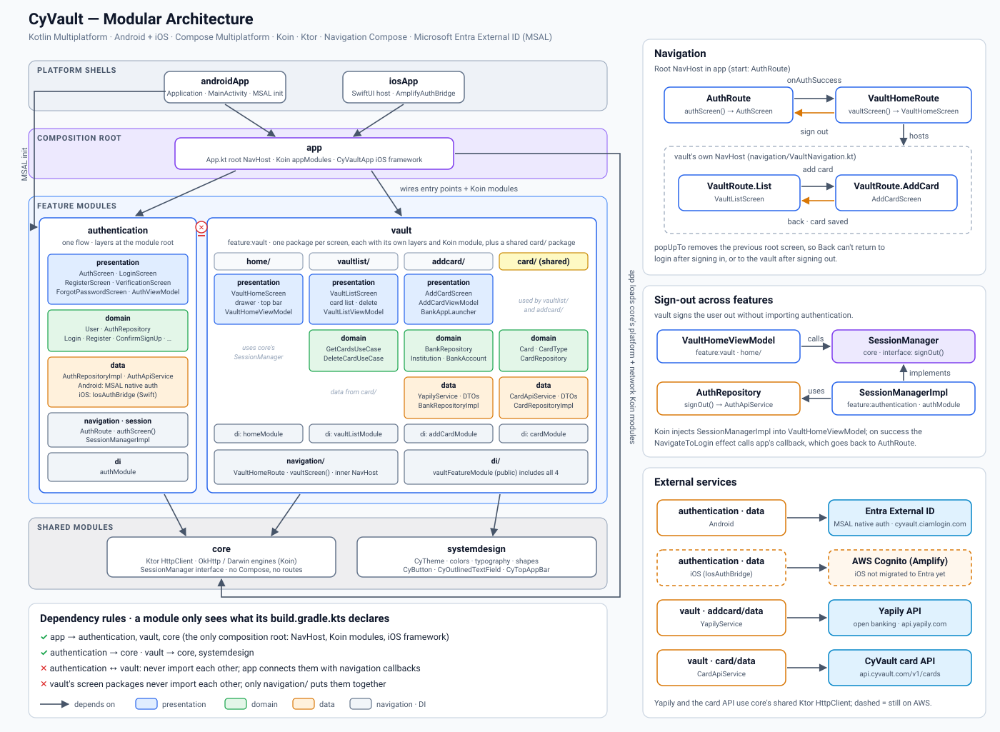

<p align="center">
  
</p>

<h1 align="center">CyVault</h1>

<p align="center">
  A Kotlin Multiplatform (Android + iOS) wallet app for managing bank cards, with open-banking account linking.
</p>

<p align="center">
  
  
  
  
</p>

---

## Overview

CyVault lets a user sign in, link a bank account through **open banking** (via the [Yapily](https://www.yapily.com/) API), and store and manage their cards in a vault.

The app is built with **Kotlin Multiplatform** and **Compose Multiplatform**. UI, ViewModels, business logic and networking are shared between Android and iOS. Only a small set of platform-specific pieces use `expect`/`actual` or native bridges.

## Features

- **Authentication**
  - **Android:** Microsoft Entra External ID with MSAL native authentication: the app's own Compose screens, no browser page
  - **iOS:** AWS Cognito via Amplify (not migrated to Entra yet)
  - Email/password sign-up with email verification code
  - Sign-in, sign-out, forgot password (sends the reset code; entering the code and a new password isn't built yet)
  - **Sign in with Google:** iOS only for now (Amplify hosted UI, deep-link callback `cyvault://callback`); on Android it needs Google set up as an identity provider in Entra
- **Add card via open banking** (multi-step flow)
  1. Pick a country and search for your bank (Yapily institutions API)
  2. Authorise access in the bank's page (Chrome Custom Tabs on Android, `SFSafariViewController` on iOS)
  3. Return through a deep link, then choose one of the linked accounts
  4. Enter card details and save
- **Vault**: list and delete saved cards

## Architecture

The project uses **Clean Architecture** with **MVI**, split into feature modules:

```
CyVault
├── androidApp       Android entry point (Application, MainActivity)
├── iosApp           iOS entry point (SwiftUI host + Amplify Swift auth bridge)
├── app              Composition root: root Compose App, NavHost, Koin setup, the only iOS framework
├── core             Shared non-UI code: Ktor client, platform DI, SessionManager
├── systemdesign     Design system: theme, colors, typography, shapes, reusable components
├── feature
│   ├── authentication   Feature: sign-in / sign-up / Google / password reset
│   └── vault            Feature: vault home, card list, add-card (open banking)
└── amplify-backend  AWS Amplify Gen 2 backend (Cognito + Google IdP), TypeScript
```

Features never depend on each other; `app` wires them through each feature's
navigation entry point (`authScreen`, `vaultScreen`) and its public Koin module.

Each feature module has its own layers. A single-flow feature (authentication) keeps them at
the module root; a multi-screen feature (vault) has one package per screen, each with its
own layers and Koin module, plus a small shared package:

```
feature/vault/…/feature/vault/
├── card/           shared by the screens: Card model, CardRepository, card API
├── home/           vault shell: drawer, top bar, sign-out
├── vaultlist/      card list
├── addcard/        add a card via open banking (Yapily)
│   ├── data/           remote services + DTOs, mappers, repository implementations
│   ├── domain/         models, repository interfaces, use cases
│   ├── presentation/   Compose screens + ViewModel (State / Intent / Effect)
│   └── di/             the screen's internal Koin module
├── navigation/     routes + vaultScreen(): the feature's single entry point
└── di/             vaultFeatureModule: the feature's only public Koin module
```

### Architecture diagram

The diagram below shows the modules as they are today: the two feature modules (authentication, and vault with its screen packages), the shared modules, the dependency rules, navigation, how vault signs out through core's `SessionManager`, and the external services.



### MVI

Every screen has three types:

- **State**: an immutable data class that the screen renders, exposed as `StateFlow`.
- **Intent**: a sealed class of user actions sent to the ViewModel.
- **Effect**: one-off events (snackbar, navigation, opening an external URL), delivered through a `Channel` so each one is consumed **exactly once** and never replayed after recomposition or rotation.

See [`docs/Effect.md`](docs/Effect.md) for why `Channel` is used instead of `SharedFlow`.

### Platform-specific code

| Concern | Shared API | Android | iOS |
|---|---|---|---|
| Authentication | `AuthApiService` (`expect`/`actual`) | MSAL native auth (Entra External ID) | Amplify Swift (Cognito), through the `IosAuthBridge` callback interface implemented in Swift |
| Open bank authorisation page | `BankAppLauncher` (`expect`/`actual`) | Chrome Custom Tabs | `SFSafariViewController` |
| DI | `platformModule` | Ktor OkHttp engine | Ktor Darwin engine |

## Tech stack

| Area | Library |
|---|---|
| Language | Kotlin 2.4 (Multiplatform) |
| UI | Compose Multiplatform 1.11, Material 3 |
| Navigation | Navigation Compose (KMP), type-safe `@Serializable` routes |
| Async | Kotlin Coroutines & Flow |
| DI | Koin 4 |
| Networking | Ktor 3 (OkHttp / Darwin), kotlinx.serialization |
| Auth | Android: Microsoft Entra External ID + MSAL 8 (native auth) · iOS: AWS Amplify (Cognito) + Google federated sign-in |
| Open banking | Yapily REST API |
| Backend | AWS Amplify Gen 2 (TypeScript), for the iOS auth backend |

## Getting started

### Requirements

- Android Studio (latest) with the Kotlin Multiplatform plugin
- Xcode (for iOS)
- JDK 17+
- An Azure account (only needed to use your own Entra tenant for Android)
- Node.js 18+ and an AWS account (only needed to deploy your own iOS auth backend)

### 1. Authentication

**Android: Microsoft Entra External ID (optional: use your own tenant)**

1. In the [Entra admin center](https://entra.microsoft.com), create an **external** tenant.
2. In that tenant, register an app (single tenant) and add the **Android** platform with the package
   name `com.cypressit.cyvault` and your signing key's hash:

   ```bash
   keytool -exportcert -alias androiddebugkey -keystore ~/.android/debug.keystore -storepass android | openssl sha1 -binary | openssl base64
   ```

3. Under **Authentication → Settings**, turn on **Allow public client flows** and **Enable native authentication**.
4. Create a user flow with **Email with password** and the **Display Name** attribute, and add the app to it.
5. Under **API permissions**, add `openid` and `offline_access`, then grant admin consent.
6. Put your client ID, tenant subdomain and redirect URI in
   `feature/authentication/src/androidMain/res/raw/auth_config_native_auth.json`, and your signature
   hash in the MSAL `BrowserTabActivity` entry of `androidApp/src/main/AndroidManifest.xml`.

**iOS: AWS Amplify (optional: deploy your own backend)**

```bash
cd amplify-backend
npm install
npx ampx sandbox secret set GOOGLE_CLIENT_ID
npx ampx sandbox secret set GOOGLE_CLIENT_SECRET
npx ampx sandbox
```

Copy the generated `amplify_outputs.json` to `iosApp/iosApp/amplify_outputs.json`.

### 2. Open banking

Create a Yapily sandbox application and put your credentials in
`feature/vault/src/commonMain/kotlin/com/cypressit/cyvault/feature/vault/addcard/data/remote/YapilyConfig.kt`.

### 3. Run

- **Android:** `./gradlew :androidApp:assembleDebug`, or use the run configuration in Android Studio
- **iOS:** open `iosApp/` in Xcode and run

## Security notes & roadmap

CyVault is a portfolio / learning project and **not production-ready**. The known gaps and the planned fixes are:

- **Yapily app secret** is currently read on the client for simplicity. In production, all Yapily calls should go through a backend proxy (for example an AWS Lambda) so the secret never ships in the app.
- **Card data**: the demo model holds a card number and CVV. A real app must never store the CVV and should keep only a **tokenised** card reference from a PCI DSS-compliant provider.
- **Card API**: `CardApiService` points to a placeholder endpoint. Planned: an Amplify Data / AppSync backend with owner-based authorization.
- **Local storage**: planned: SQLDelight for offline caching, with platform keystore/keychain encryption for sensitive data.
- **Auth**: move iOS from Amplify/Cognito to MSAL and Entra External ID, add Google as an Entra identity provider for Android, and finish the forgot-password flow (code + new password).
- More unit and UI tests for use cases and ViewModels.

## Author

**Majid Bahmani** · [GitHub](https://github.com/mbahmani90)
