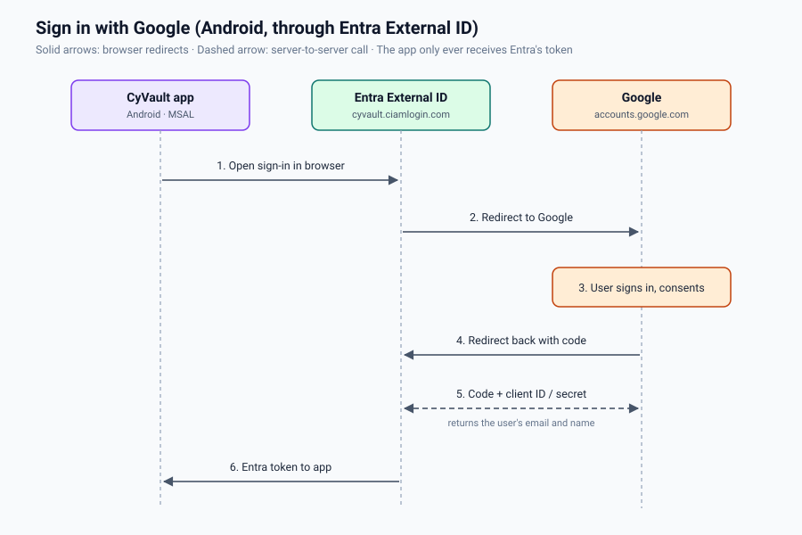
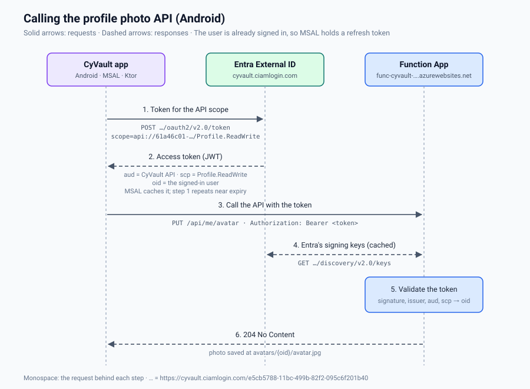
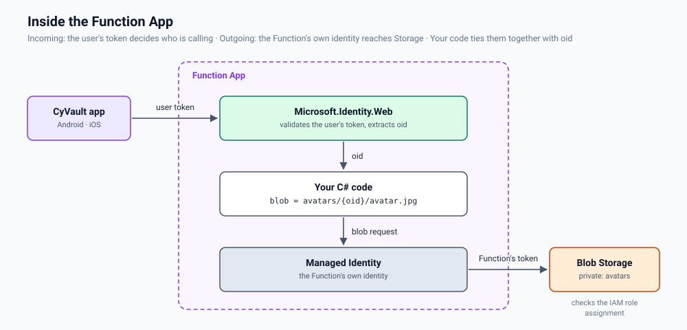
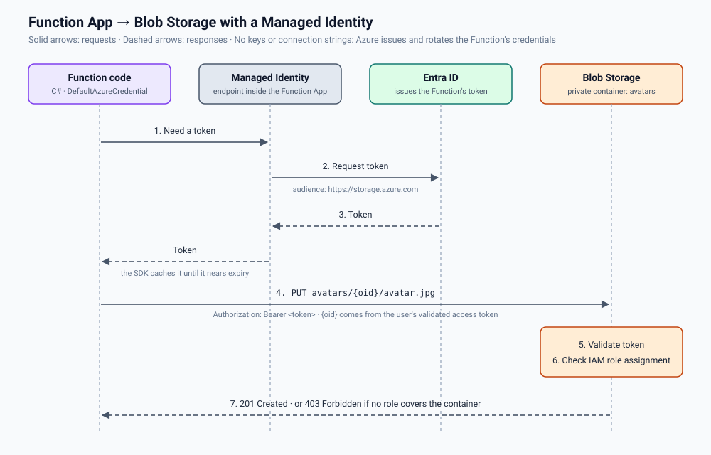

<p align="center">
  
</p>

<h1 align="center">CyVault</h1>

<p align="center">
  A Kotlin Multiplatform Android app for tracking your balances: purchases and income, totalled per currency.
</p>

<p align="center">
  
  
  
  
</p>

---

## Overview

CyVault lets a user sign in and manage their balances: record purchases and income, see the total per currency, and edit or delete entries. The balances are stored per user in the Azure backend.

The app is built with **Kotlin Multiplatform** and **Compose Multiplatform**: UI, ViewModels, business logic and networking live in shared code, and only a small set of platform-specific pieces use `expect`/`actual`.

## Features

- **Authentication**
  - Microsoft Entra External ID with MSAL native authentication: the app's own Compose screens, no browser page
  - Email/password sign-up with email verification code
  - Sign-in, sign-out, forgot password (sends the reset code; entering the code and a new password isn't built yet)
  - **Sign in with Google:** through Entra External ID with Google as an identity provider (MSAL browser flow in a browser tab)
- **Balances**
  - Add a purchase or income with a title, description, amount, currency, and date and time
  - Home shows the total per currency and every balance, newest first; tap one to edit it
  - Long press to select several balances, then select all or delete them together
  - Saved per user through the Azure balances API
- **Drawer**: the signed-in user (avatar, name, email) and sign-out
- **Profile photo**: tap the drawer avatar to pick a photo with the system Photo Picker. It's uploaded to the Azure backend with the user's Entra access token, cached in app-private storage, and removed from the device on sign-out

## Architecture

The project uses **Clean Architecture** with **MVI**, split into feature modules:

```
CyVault
├── androidApp       Android entry point (Application, MainActivity, the app's MSAL config)
├── app              Composition root: root Compose App, NavHost, Koin setup
├── core             Shared non-UI code: Ktor client, platform DI, I/O dispatcher
├── auth             Sign-in and session library: AuthClient (MSAL native auth), reusable
├── systemdesign     Design system: theme, colors, typography, shapes, reusable components
├── feature
│   ├── authentication   Feature: sign-in / sign-up / Google / password reset
│   └── vault            Feature: vault home with the balances, add-card
└── azure-backend    Azure Functions API (.NET 10) + Bicep infrastructure, deployed with azd
```

`:auth` is a library, not a feature: it has no screens and no CyVault types or IDs, and it doesn't
depend on `:core`, so another app can use it as it is. It exposes `AuthClient` (sign-in, sign-up,
Google, password reset, current user, access tokens, sign-out) and `AuthUser`. The features call it
from their data layer and map `AuthUser` to their own models: `feature:authentication` in
`AuthRepositoryImpl`, the vault in `home/data/AccountRepositoryImpl` and `ProfilePhotoApiService`.
The app supplies the Entra registration: `androidApp` passes `MsalConfig(R.raw.auth_config_native_auth)`
to Koin.

Features never depend on each other and know nothing about navigation: they don't depend on
Navigation Compose and have no routes. Each feature exposes plain screen composables
(`AuthScreen`, `VaultHomeScreen`, `AddCardScreen`) that only report events through callbacks
(`onAuthSuccess`, `onAddCardClick`, `onCardSaved`, `onSignedOut`, …). `app` defines every route
(`navigation/Routes.kt`), owns the only `NavHost` and decides where every event leads, and it
loads each feature's public Koin module.

Each feature module has its own layers. A single-flow feature (authentication) keeps them at
the module root; a multi-screen feature (vault) has one package per screen, each with its
own layers and Koin module, plus a small shared package:

```
feature/vault/…/feature/vault/
├── card/           shared by the screens: Card model, CardRepository, card API
├── home/           balances + totals per currency, drawer with sign-out and the profile photo
                    (Azure photo API client, on-device cache, photo picker)
├── addcard/        add a card
│   ├── data/           remote services + DTOs, mappers, repository implementations
│   ├── domain/         models, repository interfaces, use cases
│   ├── presentation/   Compose screens + ViewModel (State / Intent / Effect)
│   └── di/             the screen's internal Koin module
├── VaultScreens.kt the public screens: VaultHomeScreen, AddCardScreen (events out)
└── di/             vaultFeatureModule: the feature's only public Koin module
```

### Architecture diagram

The diagram below shows the modules as they are today: the two feature modules (authentication, and vault with its screen packages), the shared modules, the dependency rules, navigation, how vault signs out through `:auth`'s `AuthClient`, and the external services.


### Google sign-in flow

On Android, Google sign-in goes through Entra External ID, with Google set up as an identity provider in the tenant. Native auth only covers the in-app email screens, so for Google the app uses MSAL's browser flow (`acquireToken` with the `google.com` domain hint): it opens Entra's sign-in page in a browser tab, Entra hands the user over to Google, and Google sends a one-time code back to Entra's redirect URI. Entra exchanges that code for the user's identity with the Google client secret, then issues its own token to the app. The app never talks to Google directly, and only Entra holds the client secret.



### Profile photo API: Function App access to Blob Storage

Profile photos live in a private Blob Storage container behind the Azure Functions API in `azure-backend/` (`PUT`, `GET` and `DELETE /api/me/avatar`). On Android, the app asks MSAL for an access token with the API's `Profile.ReadWrite` scope and sends it as `Authorization: Bearer`, only on these requests. No route takes a user ID. The Function validates the upload by decoding it, turns it upright, downscales it to at most 512 px and re-encodes it as JPEG, which also drops EXIF metadata such as GPS location. The Function App reaches Storage through its **Managed Identity**, so no storage keys or connection strings exist anywhere. The SDK (`DefaultAzureCredential`) gets a token for that identity from Entra ID and sends it with each blob request. Blob Storage validates the token and checks the identity's **IAM role assignment** (`Storage Blob Data Contributor` on the `avatars` container) before allowing the write. Users get no Storage permissions at all: the Function builds every blob path from the `oid` in the user's validated access token, so each account can only reach its own photo.

Balances use the same pattern with Table Storage (`GET /api/me/balances`, and `GET`, `PUT` and `DELETE /api/me/balances/{id}`), behind the `Balance.ReadWrite` scope. Each row's `PartitionKey` is the caller's `oid` and its `RowKey` the balance ID, and the Function's identity has `Storage Table Data Contributor` on the `balances` table only. A `PUT` body is `{ "name": "Main account", "description": "Daily spending", "amount": 1250.50, "currency": "EUR" }` (description and an ISO 8601 `date` optional; without a date, a new balance is dated now and an edit keeps its date); the amount is kept as a decimal string so money is never rounded.

The app gets the access token from Entra's token endpoint, which MSAL discovers from the tenant's metadata, and the Function checks it against Entra's published signing keys:



Inside the Function App, the validated token's `oid` decides the blob, and the Function's own identity reaches Storage:



The sequence below shows the outgoing step, from the Function to Blob Storage, in detail.



### MVI

Every screen has three types:

- **State**: an immutable data class that the screen renders, exposed as `StateFlow`.
- **Intent**: a sealed class of user actions sent to the ViewModel.
- **Effect**: one-off events (snackbar, navigation, opening an external URL), delivered through a `Channel` so each one is consumed **exactly once** and never replayed after recomposition or rotation.

See [`docs/Effect.md`](docs/Effect.md) for why `Channel` is used instead of `SharedFlow`.

### Platform-specific code

| Concern | Shared API | Android |
|---|---|---|
| Authentication (`:auth`) | `AuthClient` interface, bound in `authClientModule` | `MsalAuthClient`: MSAL native auth (Entra External ID); `ActivityProvider` gives MSAL's browser sign-in the on-screen activity |
| Profile photo | `rememberProfilePhotoPicker` (`expect`/`actual`); `PickedPhotoReader` and `AvatarFileStore` interfaces bound in `homePlatformModule` | Photo Picker; `AndroidPickedPhotoReader` turns the photo upright from EXIF and scales it to 1024 px; `AndroidAvatarFileStore` caches it in `filesDir` |
| DI | `platformModule` | Ktor OkHttp engine |

## Tech stack

| Area | Library |
|---|---|
| Language | Kotlin 2.4 (Multiplatform) |
| UI | Compose Multiplatform 1.11, Material 3 |
| Navigation | Navigation Compose (KMP), type-safe `@Serializable` routes |
| Async | Kotlin Coroutines & Flow |
| DI | Koin 4 |
| Networking | Ktor 3 (OkHttp), kotlinx.serialization |
| Auth | Microsoft Entra External ID + MSAL 8 (native auth) |
| Backend | Azure Functions (.NET 10 isolated, Flex Consumption), Microsoft.Identity.Web, Blob Storage, SkiaSharp, Bicep + Azure Developer CLI |

## Getting started

### Requirements

- Android Studio (latest) with the Kotlin Multiplatform plugin
- JDK 17+
- An Azure account (only needed to use your own Entra tenant)
- For the Azure backend: see [`azure-backend/README.md`](azure-backend/README.md#requirements)

### 1. Authentication

**Microsoft Entra External ID (optional: use your own tenant)**

1. In the [Entra admin center](https://entra.microsoft.com), create an **external** tenant.
2. In that tenant, register an app (single tenant) and add the **Android** platform with the package
   name `com.cypressit.cyvault` and your signing key's hash:

   ```bash
   keytool -exportcert -alias androiddebugkey -keystore ~/.android/debug.keystore -storepass android | openssl sha1 -binary | openssl base64
   ```

3. Under **Authentication → Settings**, turn on **Allow public client flows** and **Enable native authentication**.
4. Create a user flow with **Email with password** and the **Display Name** attribute, and add the app to it.
5. Under **API permissions**, add `openid` and `offline_access`, then grant admin consent.
6. Put your client ID, tenant subdomain and redirect URI in
   `androidApp/src/main/res/raw/auth_config_native_auth.json`, and your signature
   hash in the MSAL `BrowserTabActivity` entry of `androidApp/src/main/AndroidManifest.xml`.
7. Optional, for **Sign in with Google**:
   - In the [Google Cloud Console](https://console.cloud.google.com), create a project, set up the
     OAuth consent screen (Google Auth Platform) as **External**, and add your Gmail address as a
     test user while the app is in Testing mode.
   - Create an OAuth client of type **Web application** with these redirect URIs, where `<tenant-ID>`
     is your tenant's ID and `<tenant>` its subdomain:

     ```
     https://login.microsoftonline.com
     https://login.microsoftonline.com/te/<tenant-ID>/oauth2/authresp
     https://login.microsoftonline.com/te/<tenant>.onmicrosoft.com/oauth2/authresp
     https://<tenant-ID>.ciamlogin.com/<tenant-ID>/federation/oidc/accounts.google.com
     https://<tenant-ID>.ciamlogin.com/<tenant>.onmicrosoft.com/federation/oidc/accounts.google.com
     https://<tenant>.ciamlogin.com/<tenant-ID>/federation/oauth2
     https://<tenant>.ciamlogin.com/<tenant>.onmicrosoft.com/federation/oauth2
     ```

   - In Entra, go to **External Identities → All identity providers → Google** and enter the
     Google client ID and secret, then tick **Google** under the user flow's **Identity providers**.
     The secret stays in Entra; the app never needs it.

### 2. Azure backend (profile photo and balances API)

The backend's requirements, environments, local run and deployment are in
[`azure-backend/README.md`](azure-backend/README.md).

### 3. Run

`./gradlew :androidApp:assembleDebug`, or use the run configuration in Android Studio.

## Continuous integration

The same flow runs in two places, on every pull request and push to `main`:
[`.github/workflows/ci.yml`](.github/workflows/ci.yml) in GitHub Actions and
[`azure-pipelines.yml`](azure-pipelines.yml) in Azure Pipelines. Changes that only touch the backends,
`docs/` or Markdown skip it.

```
Build ─┬─► Unit tests · Android Lint · Code style (· SonarQube) ─► CI result
       └─► E2E tests ─► E2E result
```

| Job | Gradle task |
|---|---|
| Build | `:androidApp:assembleDebug` |
| Unit tests | `testDebugUnitTest testAndroidHostTest` |
| Android Lint | `:androidApp:lintDebug` (also lints the library modules) |
| Code style | `ktlintCheck` (rules in `.editorconfig`; fix with `./gradlew ktlintFormat`) |
| SonarQube | `koverXmlReport`, then SonarQube Cloud analysis; fails if the Quality Gate fails |
| CI result | Fails if any job above failed |
| E2E tests | `:e2e:e2eTest` through `e2e/run-e2e.sh`: Appium drives the debug APK on an emulator |
| E2E result | Fails if E2E tests failed; **CI result** doesn't depend on it |

In GitHub Actions the first job, **Changes**, does the path filtering; Azure does it with its
`paths.exclude` trigger and groups the checks in a **Verify** stage.

To set it up:

1. In Azure DevOps, create a pipeline from this GitHub repository and pick the existing `azure-pipelines.yml`.
2. In GitHub, add a branch protection rule on `main` that requires the **CI result** check.
3. For E2E, create a test account in the debug Entra tenant (the tests delete every balance on it) and add
   its credentials as `E2E_EMAIL` and `E2E_PASSWORD`: repository secrets in GitHub, secret pipeline variables
   in Azure DevOps. The Azure E2E stage needs an agent with KVM for the emulator.
4. For SonarQube, first turn off Automatic Analysis in the SonarQube Cloud project (Administration →
   Analysis Method). Both CIs report to the same project, so the latest analysis of a branch is the one shown.
   - GitHub Actions: add a SonarQube Cloud token as the repository secret `SONAR_TOKEN`, and the
     repository variables `SONAR_ORGANIZATION` and `SONAR_PROJECT_KEY` with your project's values. Until
     `SONAR_PROJECT_KEY` is set the SonarQube job is skipped.
   - Azure Pipelines: install the SonarQube Cloud extension and add a service connection named `SonarCloud`;
     the organization and project keys are in `azure-pipelines.yml`. `sonarEnabled: false` leaves the
     SonarQube job out of the run.
   - Quality Gate: both scans wait for SonarQube Cloud's verdict (`sonar.qualitygate.wait=true`, up to 5 minutes).
     When the gate fails, the SonarQube job fails and so does **CI result**, which blocks the PR. What the gate
     checks is set in SonarQube Cloud (Project → Quality Gate); the default "Sonar way" looks at new code only:
     no new bugs or vulnerabilities, all new security hotspots reviewed, ≥ 80% coverage and ≤ 3% duplication.
     The failing conditions are on the project's page in SonarQube Cloud.

To run the E2E tests locally, start an emulator or connect a phone, start `appium` (with `ANDROID_HOME`
and `JAVA_HOME` set), put the test account in the git-ignored `e2e/.env`, then run `./e2e/run-e2e.sh`.

## Security notes & roadmap

CyVault is a portfolio / learning project and **not production-ready**. The known gaps and the planned fixes are:

- **Card data**: the demo model holds a card number and CVV. A real app must never store the CVV and should keep only a **tokenised** card reference from a PCI DSS-compliant provider.
- **Card API**: `CardApiService` points to a placeholder endpoint. Planned: move it to the Azure Functions API, with every card keyed by the caller's `oid`.
- **Local storage**: planned: SQLDelight for offline caching, with Android Keystore encryption for sensitive data.
- **Auth**: finish the forgot-password flow (code + new password).
- More unit and UI tests for use cases and ViewModels.

## Author

**Majid Bahmani** · [GitHub](https://github.com/mbahmani90)
